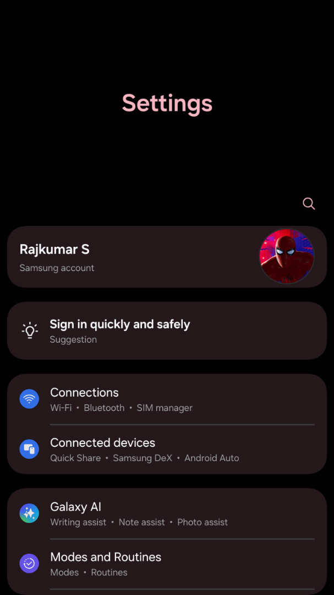
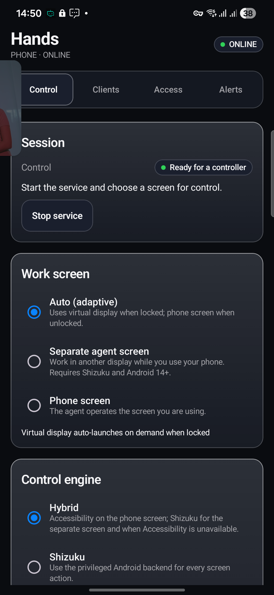
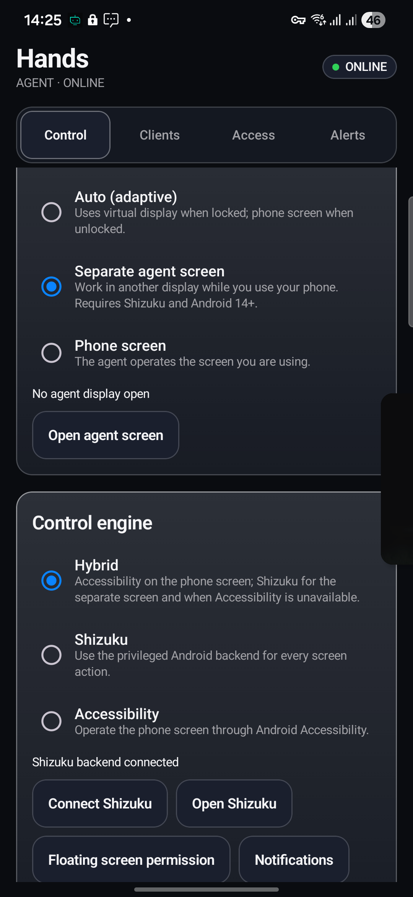
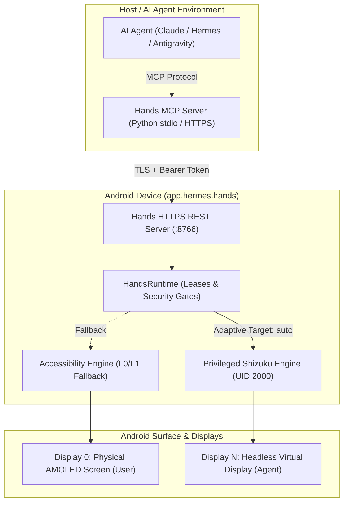

# Hands (app.hermes.hands)

<p align="center">
  <b>Sovereign, Headless, Privileged Android Automation for AI Agents</b>
</p>

<p align="center">
  
  
  
  
  
  
</p>

---

**Hands** is an open-source, sovereign Android automation platform built specifically for autonomous AI agents. Unlike traditional ADB scripts or single-screen accessibility tools, Hands allows AI agents to control native Android applications on an **isolated, headless virtual display** without stealing user focus, and even when the physical smartphone is **locked or completely screen-off**.

---

## Visual Showcase (Verified on Samsung Galaxy S22)

| Headless Virtual Agent Screen (Screen-Off) | Hands Service & Shizuku Status | Adaptive Auto Work Screen |
| :---: | :---: | :---: |
|  |  |  |
| *Settings launched & captured headlessly on virtual display while physical phone screen is sleeping* | *Foreground service running with privileged Shizuku backend connected* | *Auto mode routing to virtual display whenever phone is locked or screen-off* |

---

## Key Highlights

- **Dual-Display Architecture**: Operates on an independent secondary virtual display (Display $N$) without disrupting the user's physical display (Display 0).
- **True Screen-Off Headless Execution**: Decoupled from physical display composition using a low-latency `<50ms` headless `ImageReader`. Operates through deep sleep without lighting up the phone.
- **Privileged Shizuku Integration**: Multi-display input injection (`click`, `swipe`, `scroll`, `type`), hardware display captures, and process isolation via Shizuku (`UID 2000`).
- **Model Context Protocol (MCP)**: Native Python MCP server exposing **94 mobile tools** directly to Claude Desktop, Hermes Agent, Antigravity, or Cursor.
- **Privileged App & Device Control**: Silent background app installation/uninstallation via Shizuku (`pm install -r -d -g`), hardware torch/flashlight control, comprehensive clock alarms & timers, full file system access, and system settings.
- **Safety Boundaries**: Arm-first leased access (`device.arm`), protected package denylists, hardware-backed token encryption, and automatic private entry masking (`DevicePrivacy`).
- **Doze-Proof Service**: Holds low-power `PARTIAL_WAKE_LOCK` to keep the HTTPS REST server (`:8766`) responsive over Tailscale or local Wi-Fi while sleeping.

---

## Architecture Overview



---

## Repository Structure

```
hands/
├── hands-app/         # The sovereign Android application (Services, Runtime, HTTP Server, UI)
├── hands-engine/      # Privileged Shizuku backend, AIDL service, gestures, and display capture
├── hands-client/      # Android client SDK for third-party apps integrating Hands
├── feature-device/    # Device accessibility, toolboxes, notification listener, system controls
├── core-design/       # Cyberpunk theme, glassmorphic UI controls, and typography
├── core-model/        # Core domain models and JSON serialization
├── domain/            # Device lane policy, gestures, and permission contracts
├── hands-mcp/         # Python Model Context Protocol server, CLI tool, and tool catalog
└── docs/              # Comprehensive guides (architecture, API, Shizuku, use cases, MCP)
    ├── architecture.md
    ├── api.md
    ├── mcp-setup.md
    ├── shizuku-guide.md
    ├── use-cases.md
    └── images/
```

---

## Prerequisites & Dependencies

### Android
- Android 12+ (API 31+) — tested thoroughly on Android 14 (OneUI 6.1, Snapdragon 8 Gen 1).
- Java 17+ (JDK 17).
- Android SDK Build-Tools 35.0.0+.
- [Shizuku](https://shizuku.rikka.app/) (v13.1.5+) configured via Wireless Debugging or Root.

### Host / Client
- Python 3.10+ (for `hands-mcp`).
- Network connectivity to device (Local Wi-Fi or Tailscale VPN).

---

## Quick Start Guide

### Step 1: Build & Install Hands APK

```bash
# Clone the repository
git clone https://github.com/your-org/hands.git
cd hands

# Build debug APK
./gradlew :hands-app:assembleDebug

# Install to connected device via ADB
adb install -r --user 0 hands-app/build/outputs/apk/debug/hands-app-debug.apk
```

### Step 2: Grant Permissions & Set Up Shizuku

1. Enable **Developer Options** and start **Shizuku** via Wireless Debugging (see [Shizuku Guide](docs/shizuku-guide.md)).
2. In Shizuku, toggle authorization for **Hands** to **ON**.
3. Grant secure settings permission via ADB (enables automatic accessibility self-healing):
   ```bash
   adb shell pm grant app.hermes.hands android.permission.WRITE_SECURE_SETTINGS
   ```

### Step 3: Start Hands Service

Open the Hands app on the phone and tap **Start service**. The persistent notification will confirm:
`Hands · Local and network API running · ready for a controller`

### Step 4: Issue a Client Token

In the Hands app:
1. Navigate to the **Clients** tab.
2. Tap **Add Client** (e.g. `Laptop MCP`).
3. Copy the 43-character Bearer token and save it to `~/.config/hands/token`.

---

## Connecting via MCP (Claude / Antigravity / Cursor)

Add the Hands MCP server to your MCP client configuration (e.g. `claude_desktop_config.json`):

```json
{
  "mcpServers": {
    "hands": {
      "command": "python3",
      "args": [
        "/path/to/hands/hands-mcp/hands_mcp.py",
        "--endpoint", "https://<phone-ip>:8766",
        "--token-file", "/Users/yourname/.config/hands/token",
        "--insecure"
      ]
    }
  }
}
```

Detailed instructions for Hermes Gateway and other clients are in [MCP Setup Guide](docs/mcp-setup.md).

---

## Direct REST API Example (Python)

```python
import json, ssl, urllib.request

ctx = ssl.create_default_context()
ctx.check_hostname = False
ctx.verify_mode = ssl.CERT_NONE

TOKEN = "your-43-char-token-here"
URL = "https://100.105.213.54:8766/v1/commands"

def send(action, args=None, lease_id=None):
    payload = {"controller_id": "my-script", "action": action, "arguments": args or {}}
    if lease_id: payload["lease_id"] = lease_id
    req = urllib.request.Request(
        URL,
        data=json.dumps(payload).encode("utf-8"),
        headers={"Content-Type": "application/json", "Authorization": f"Bearer {TOKEN}"}
    )
    with urllib.request.urlopen(req, context=ctx) as r:
        return json.loads(r.read().decode("utf-8"))

# 1. Arm into adaptive virtual screen
arm = send("device.arm", {"duration_seconds": 60})
lease = arm["result"]["lease_id"]
print(f"Armed on display {arm['result']['agent_screen']['display_id']}")

# 2. Launch Settings app headlessly
send("device.open_app", {"package": "com.android.settings"}, lease_id=lease)

# 3. Take UI snapshot
snapshot = send("device.snapshot", {}, lease_id=lease)
print(f"Found {len(snapshot['result']['nodes'])} UI nodes")

# 4. Disarm
send("device.disarm", lease_id=lease)
```

For the complete API specification, see [API Documentation](docs/api.md).

---

## Testing

```bash
# Run all Android unit tests
./gradlew :hands-app:testDebugUnitTest :hands-engine:testDebugUnitTest :hands-client:testDebugUnitTest :domain:test

# Run Hands MCP test suite (91 tests)
python3 -m unittest discover -s hands-mcp/tests/ -p "test_*.py"
```

---

## Documentation Index

- [Architecture & Virtual Display Engine](docs/architecture.md)
- [REST API & Capability Specifications](docs/api.md)
- [Model Context Protocol (MCP) Setup](docs/mcp-setup.md)
- [Shizuku Configuration & Permissions](docs/shizuku-guide.md)
- [Real-World Use Cases](docs/use-cases.md)

---

## License

Hands is licensed under the Apache 2.0 License.
